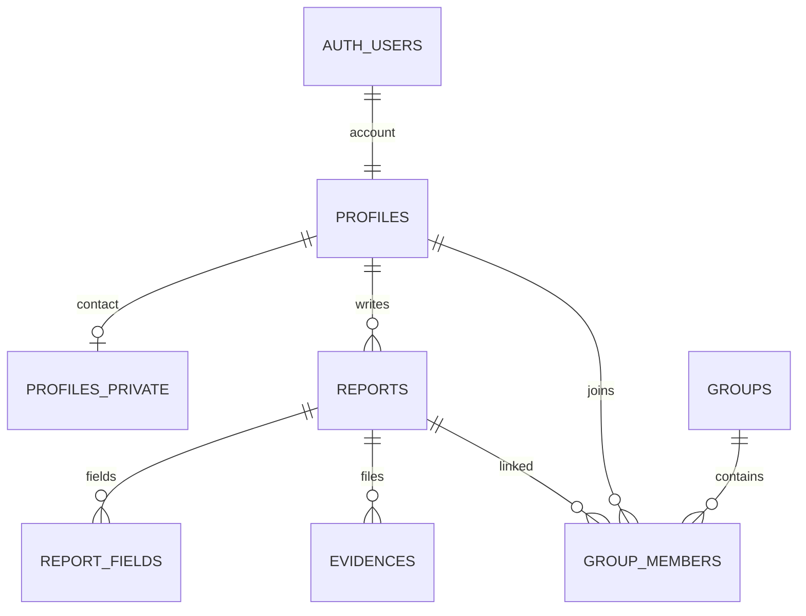
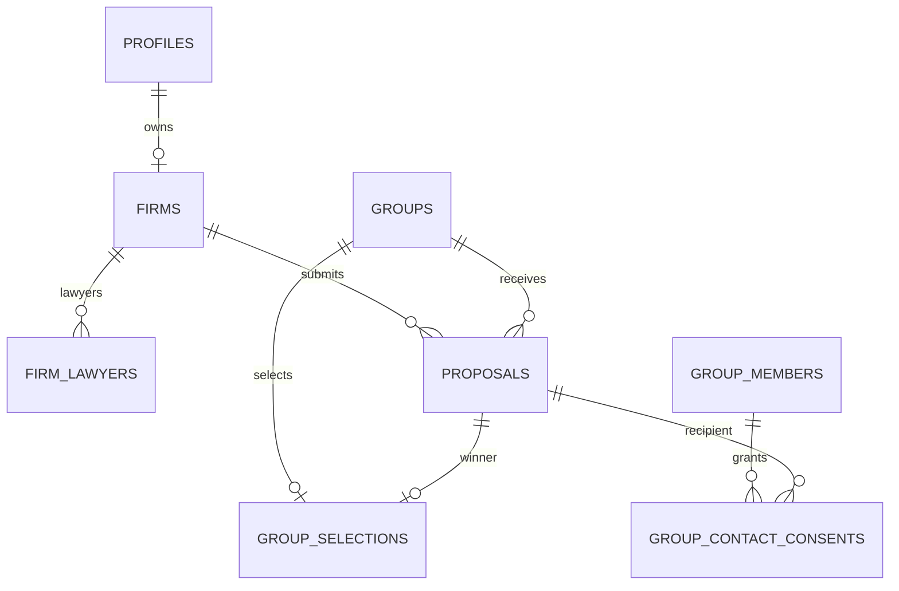
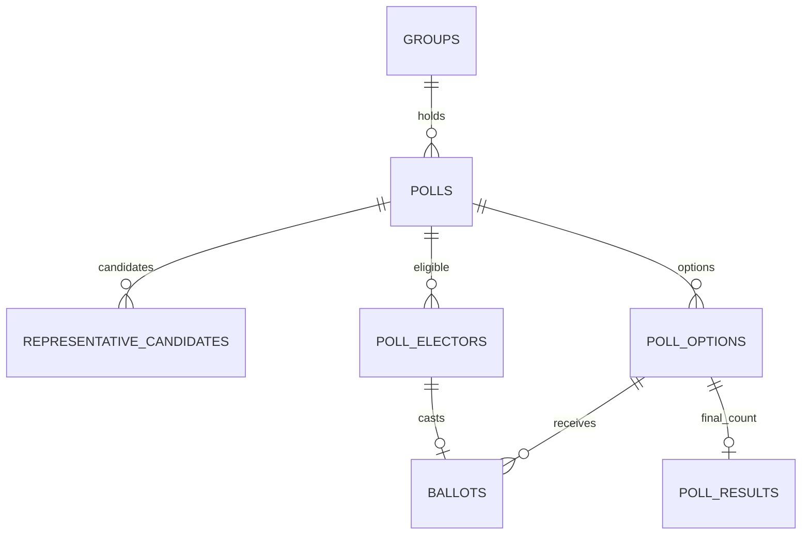

# HANDE DB 설계 수정본 — 전달용

2026-11-11 · 설계/연동 계약 검토본 · 실제 DB 미적용


---

# HANDE 데이터베이스 설계

기준: `HANDE_기능명세서_v2.docx`(2026-11-10)와 이후 사용자가 확정한 7.2 의견. Supabase Auth + PostgreSQL + Storage를 사용한다. 이 PR은 **구현 전 설계안**이며 실행 SQL, RLS 정책, RPC 구현이나 실제 DB 변경은 포함하지 않는다.

1. 테이블·컬럼·관계: 어떤 정보를 왜 저장하는지, ERD, 제약과 인덱스
2. 권한·기능 처리 계약: 사용자별 접근 범위, 투표·동의·업로드 처리
3. 구현 순서·검증 항목: BE1/BE2/FE 연결 지점, 검토가 필요한 세부 규칙

4. BE1·BE2 연동 계약 수정본: 이름 규칙, 함수별 입력·출력, 오류·빈 결과, AI 저장·익명 집계 제안

이번 수정에서는 기존 테이블 설계를 유지하면서 임시 API 제작에 필요한 계약을 추가했다. **협의용 제안과 확정된 7.2를 구분**한다. 상세 우선순위: 테이블·타입은 schema.md, 함수 응답 형태는 integration-contract.md, 권한은 permissions-and-rpc.md.

## 확정 기준

| 항목 | 반영 내용 |
| --- | --- |
| 스택 | Supabase 기반. Java/Spring 가정은 사용하지 않는다. |
| 투표 | 대표자가 기간 설정, 서버 시각 기준 자동 마감 |
| 득표 | 로펌별 득표는 마감 전에도 공개. 개별 투표자의 선택은 본인만 조회 |
| AI | 브라우저 분석, 초기 시간 초과 20초. DB가 아닌 AI/FE 모듈 책임 |
| 증빙 | JPG/JPEG, PNG, PDF, 파일당 10MB. 한글/Word는 사용자가 PDF로 변환 |
| 로펌 승인 | 가입 후 pending. 운영자가 DB에서 승인/반려. 새로고침/재조회로 반영 |
| 실명·연락처 | 가입 때 수집. 본인이 수정 가능. 선정 로펌 제공은 별도 동의 후 |
| 그룹 병합 | 이번 범위에서 제외 |
| 피해 유형 | 개인정보 유출부터 지원 |
| 대표자 | v2 유지: 10명 달성 후 자원자 중 투표로 선정. 개설자 자동 대표자 아님 |

기존 명세서의 '가입 때 연락처 미수집', '로펌 득표 마감 후 공개'보다 위 합의가 우선한다. 최대 파일 개수, 동점 처리 세부 절차 등은 확정 사항과 구분해 문서에 표시했다.

## 기존 테이블 후보와의 대응

| 이전 후보 | 이번 설계 | 이유 |
| --- | --- | --- |
| users | auth.users + profiles | 인증 계정과 서비스 프로필 분리. 비밀번호/해시를 별도 테이블에 복제하지 않음 |
| victim_profiles | profiles + profiles_private | 닉네임과 실명·연락처 분리 |
| law_firms | firms + firm_lawyers | 로펌 하나에 여러 담당 변호사 |
| damage_reports | reports + report_fields + evidences | 원문, AI/수정 결과, 파일 분리 |
| case_groups | groups + group_members | 그룹과 참여 관계 분리 |
| votes/ballots | polls + poll_options + poll_electors + ballots | 대표자·대응 방법·로펌 투표 및 재투표 회차 표현 |
| case_participations | group_contact_consents | v2 범위는 로펌 연결 동의. 법적 소송 위임/참여 확정과 동일시하지 않음 |
| case_updates | notices + group_events | 사용자 공지와 시스템 상태 이력 분리 |
| notifications | notifications | 수신자별 읽음 처리 |

## 설계 원칙

- 관계와 접근 조건을 먼저 검토하고, 다음 구현 PR에서 마이그레이션/RLS/RPC를 함께 적용한다.
- FK/UNIQUE/CHECK는 DB에서 보장한다. 시간·권한·단계·다른 행과의 관계는 트랜잭션 RPC에서도 검사한다.
- 공개 조회는 허용 컬럼만 반환한다. RLS는 행 단위이므로 '닉네임만 공개'를 RLS 하나로 해결한다고 가정하지 않는다.
- 공개 그룹명·조건·AI 생성 문장에는 피해 원문이나 개인 식별정보를 그대로 복사하지 않는다. 공개 전 정제/확인한다.
- 그룹 인원, 득표, 증거 보유율은 원본 관계에서 계산한다. 브라우저가 집계·승인·선정 결과를 직접 쓰지 않는다.
- 모든 시간은 timestamptz로 저장하고 화면에서 Asia/Seoul로 표시한다.

## 참고한 공식 문서

- [Supabase 사용자 데이터 관리](https://supabase.com/docs/guides/auth/managing-user-data)
- [RLS](https://supabase.com/docs/guides/database/postgres/row-level-security)
- [컬럼 권한](https://supabase.com/docs/guides/database/postgres/column-level-security)
- [DB 함수](https://supabase.com/docs/guides/database/functions)
- [Cron](https://supabase.com/docs/guides/cron)
- [파일 제한](https://supabase.com/docs/guides/storage/uploads/file-limits)


---

# 테이블·컬럼·관계

표기: PK=기본키, FK=외래키, UQ=유일 제약, NN=필수. `?`만 NULL 허용, 그 외 NN. uuid PK는 gen_random_uuid(), created_at은 now() 기본값. 코드값은 text+CHECK를 제안하며 실제 SQL 적용은 다음 구현 단계다. 개인·로펌 정보는 전부 예시 데이터로만 개발한다.

## 1. 계정과 로펌

### auth.users (Supabase 관리)

이메일·비밀번호 해시·인증 세션은 Supabase Auth가 관리한다. 직접 생성한 users 테이블에 비밀번호를 저장하지 않는다. 아래 profiles.id만 auth.users.id를 참조한다.

### profiles

| 컬럼 | 타입/제약 | 용도 |
| --- | --- | --- |
| id | uuid PK, FK auth.users.id | 인증 사용자와 1:1 |
| role | text CHECK user/firm | 가입 유형. 대표자와 운영자는 별도로 표현 |
| nickname | text, 길이 1~40 | 일반 사용자 표시 이름. 중복 닉네임 허용 제안 |
| created_at, updated_at | timestamptz | 가입/수정 시각 |

role은 가입 완료 후 직접 수정 불가. 로펌 표시 이름은 firms.firm_name에서 읽는다. nickname 길이·중복 정책은 구현 기본안이며 팀 변경 가능.

### profiles_private

| 컬럼 | 타입/제약 | 용도 |
| --- | --- | --- |
| user_id | uuid PK, FK profiles.id | 개인 프로필 1:1 |
| real_name | text | 가입 시 입력받는 실명 |
| phone | text | 앞자리 0 보존, 정규화 후 저장 |
| updated_at | timestamptz | 본인 수정 시각 |

로펌 제공 동의는 이 테이블의 전역 boolean으로 저장하지 않는다. 그룹별 동의 테이블을 사용한다. 일반 사용자 가입 완료 시 반드시 이 행이 존재하도록 가입 완료 RPC에서 검사한다.

### user_terms_acceptances

`id uuid PK`, `user_id uuid FK profiles.id`, `document_key text`, `version text`, `accepted_at timestamptz`.
UQ(user_id, document_key, version). 가입 약관/수집 안내 버전의 수락 이력. 로펌에 대한 정보 제공 동의와 별개다. 필수 문서 목록은 FE/기획이 제공한다.

### app_operators (비공개 스키마 권장)

`user_id uuid PK FK profiles.id`, `granted_at timestamptz`.
운영자 허용 목록. 신뢰된 DB 관리자만 관리한다. 사용자 입력 metadata나 수정 가능한 profiles 값으로 운영자를 승격하지 않는다.

### firms

| 컬럼 | 타입/제약 | 용도 |
| --- | --- | --- |
| id | uuid PK | 로펌 ID |
| owner_id | uuid FK profiles.id, UQ | 이번 버전은 계정 하나당 로펌 하나 |
| firm_name | text | 공개용 로펌명 |
| biz_no | text UQ, 숫자 10자리 CHECK | 사업자번호. 숫자형 아님 |
| biz_status | text CHECK unchecked/active/suspended/closed/unknown | 사업자 상태 |
| biz_checked_at | timestamptz? | 신뢰된 국세청 조회 완료 시각 |
| cert_path | text | 비공개 사업자등록증 경로 |
| approval_status | text CHECK pending/approved/rejected, 기본 pending | 운영자 승인 |
| reviewed_by | uuid? FK app_operators.user_id | 검토자 |
| reviewed_at | timestamptz? | 검토 시각 |
| reject_reason | text? | rejected이면 필수 CHECK |
| created_at, updated_at | timestamptz | 이력 |

owner 역할=firm 검사. 사업자 상태/승인 필드는 소유 로펌이 변경할 수 없다. 사업자번호·등록증·변호사 자격 정보 변경 시 재검토 필요 여부는 미정; 구현 전에는 승인된 계정의 해당 필드 직접 변경을 막는다.

### firm_lawyers

`id uuid PK`, `firm_id uuid FK firms.id`, `name text`, `reg_no text`, `created_at timestamptz`.
UQ(firm_id, reg_no). 제안서 제출 시 최소 1명 존재 검사. 번호 입력 자체를 자격 확인 완료로 취급하지 않는다.

## 2. 피해 사례와 증빙

### reports

`id uuid PK`, `user_id uuid FK profiles.id`, `raw_text text CHECK 길이 1~2000`, `status text CHECK draft/organized/submitted`, `created_at/updated_at timestamptz`.
UQ(id,user_id): 참여 관계에서 사례 작성자와 참여자가 동일한지 복합 FK로 확인한다. 비어 있는 초안은 브라우저 임시 저장으로 처리하고 DB 저장은 1자 이상. 일반 사용자만 생성한다.

### report_fields

| 컬럼 | 타입/제약 | 용도 |
| --- | --- | --- |
| report_id | uuid FK reports.id, 복합 PK 일부 | 대상 사례 |
| key | text CHECK company/type/notice_date/leaked/secondary/card, 복합 PK 일부 | 정리 항목 |
| ai_value | jsonb? | AI 원본 추출값 |
| quote | text? | AI가 사용한 원문 근거 |
| user_value | jsonb? | 사용자 수정값 |
| source | text CHECK ai/user | 현재 최종값 출처 |
| needs_check | boolean, 기본 true | 확인 필요 여부 |
| updated_at | timestamptz | 수정 시각 |

최종값은 source=user이면 user_value, 아니면 ai_value. JSON null을 값으로 사용하지 않고 SQL NULL을 사용한다. source=user이면 user_value 필수. 기간은 from/to(ISO 날짜)·precision, 유출 정보는 문자열 배열, 예/아니오/모름은 yes/no/unknown 등 key별 JSON 계약을 AI 담당자와 확정한다. 사용자 수정 시 ai_value/quote를 덮어쓰지 않는다. 현재 scope에서 type은 개인정보 유출만 제출 허용. 브라우저 AI 값은 검증된 사실/권한 판단 근거로 취급하지 않는다.

### evidences

`id uuid PK`, `report_id uuid FK reports.id`, `kind text`, `bucket_id text`, `object_path text UQ`, `original_name text`, `mime_type text CHECK image/jpeg,image/png,application/pdf`, `size_bytes bigint CHECK >0 AND <=10000000`, `status text CHECK pending/ready/failed`, `created_at timestamptz`, `uploaded_at timestamptz?`.

10MB는 10,000,000 bytes로 통일하는 구현 제안이다. Storage 설정/FE 표시와 동일하게 맞춘다. 최대 개수는 아직 미정이며 5개를 확정값으로 넣지 않는다. 파일 실체는 Storage, DB에는 경로와 메타데이터만 저장한다. ready만 통계에 포함하고 pending/실체 누락 파일은 제외한다.

## 3. 그룹과 동의

### groups

| 컬럼 | 타입/제약 | 용도 |
| --- | --- | --- |
| id | uuid PK | 그룹 ID |
| name, company | text | 공개용 제목/기업 |
| harm_type | text CHECK privacy_leak | 초기 피해 유형 |
| period_start, period_end | date? | 사건 기간. 둘 다 있으면 start<=end |
| description, conditions | text | 공개 설명/참여 조건 |
| required_evidence | text[] 기본 빈 배열 | 필요한 증거 종류 |
| goal | integer? CHECK >0 | 선택 목표 인원 |
| deadline | timestamptz? | 선택 모집 마감 |
| proposal_deadline | timestamptz? | 로펌 제안 접수 마감. 투표 마감과 구분 |
| status | text CHECK recruiting/connecting/in_progress/closed | 4단계 상태 |
| sub_status | text CHECK recruiting/rep_election/method_vote/proposal_collection/firm_vote/connected/closed | 세부 상태 |
| method | text? CHECK med/consumer/collective/suit | 확정 대응 방법 |
| created_by | uuid FK profiles.id | 개설자, 자동 대표자 아님 |
| result_summary | text? | 종결 요약 |
| created_at, updated_at | timestamptz | 이력 |

대표자는 group_members.is_rep, 선정 제안은 group_selections, 투표 시각은 polls에서 관리한다. groups에 대표자/선정 제안/투표 마감 시각을 중복 저장하지 않는다. 상태 조합은 permissions-and-rpc.md의 전이 규칙으로 제한한다.

### group_members

`group_id uuid FK groups.id`, `user_id uuid FK profiles.id`, `report_id uuid`, `damage_level text?`, `is_rep boolean 기본 false`, `joined_at timestamptz`, `left_at timestamptz?`, PK(group_id,user_id).

FK(report_id,user_id) → reports(id,user_id). 부분 UQ(group_id) WHERE is_rep AND left_at IS NULL: 활성 대표자는 그룹당 최대 1명. CHECK NOT is_rep OR left_at IS NULL. 피해 시기는 report_fields에서 조회하며 공개 목록에 원문/유출 정보/연락처를 붙이지 않는다. 같은 사례의 여러 그룹 연결 허용 여부는 미정이므로 report_id 단독 UQ를 임의로 만들지 않는다. 현재 합류 시각으로 재가입 자격을 판별한다.

### group_selections

`group_id uuid PK FK groups.id`, `proposal_id uuid UQ`, `firm_poll_id uuid UQ`, `selected_at timestamptz`.
FK(proposal_id,group_id) → proposals(id,group_id), FK(firm_poll_id,group_id) → polls(id,group_id). 투표 종류=firm, 마감/단독 최다 득표, 해당 제안 유효성을 마감 RPC에서 검증. 매핑의 로펌은 proposals.firm_id로 결정한다.

### group_contact_consents

`id uuid PK`, `group_id uuid`, `user_id uuid`, `proposal_id uuid`, `consent_version text`, `granted_at timestamptz`, `revoked_at timestamptz?`.
FK(group_id,user_id) → group_members PK. FK(proposal_id,group_id) → proposals(id,group_id). 부분 UQ(group_id,user_id) WHERE revoked_at IS NULL. revoked_at>=granted_at 검사. 동의할 때 실제 선정 제안인지 서버에서 확인한다.

동의 범위는 해당 그룹·해당 선정 제안의 로펌에 대한 실명/연락처 제공이다. 다른 그룹이나 다른 로펌에 자동 적용하지 않는다. 철회 시 앞으로의 조회를 차단한다(이미 내려받은 정보 회수와는 다름). 연락처 수정 후 재확인 절차는 구현 기본안으로 제공 동의를 다시 받는 방식을 제안한다. 증거 파일 제공 동의와 동일하게 취급하지 않는다. 법적 소송 참여 확정을 의미하지 않는다.

### notices / group_events

- notices: `id uuid PK`, `group_id uuid FK groups.id`, `author_id uuid FK profiles.id`, `title text`, `body text`, `created_at/updated_at timestamptz`. 대표자 작성 공지.
- group_events: `id uuid PK`, `group_id uuid FK groups.id`, `actor_id uuid? FK profiles.id`, `type text`, `payload jsonb`, `created_at timestamptz`. 시스템 단계 전이·선정 이력. 클라이언트 직접 쓰기 불가. payload에 개인정보를 포함하지 않는다.

v1의 사건번호/법원/소장 등 소송 관리 테이블은 v2의 연결 중심 범위에 추가하지 않는다. notices/group_events는 v2 대시보드의 소식과 상태 이력을 지원한다.

## 4. 투표와 제안서

### proposals

`id uuid PK`, `group_id uuid FK groups.id`, `firm_id uuid FK firms.id`, `retainer_fee numeric(14,0) CHECK >=0`(1인당 KRW), `success_fee_pct numeric(5,2) CHECK 0~100`, `period text`, `strategy text`, `lawyer_count integer CHECK >0`, `lead_lawyer text`, `status text CHECK draft/submitted/withdrawn`, `submitted_at timestamptz?`, `created_at/updated_at timestamptz`.
UQ(group_id,firm_id), UQ(id,group_id). 철회 후에도 새 행 대신 같은 제안 수정/재제출로 중복 방지. submitted에는 submitted_at 필수. 선정 여부는 group_selections에서 계산해 상태 이중 관리 방지. 추가 비용·유사 경험은 v2 F-03에 필수로 명시되지 않아 추가하지 않음.

### polls

| 컬럼 | 타입/제약 | 용도 |
| --- | --- | --- |
| id | uuid PK | 투표 회차 ID |
| group_id | uuid FK groups.id | 그룹 |
| kind | text CHECK representative/method/firm | 대표자/대응 방법/로펌 |
| round_no | integer CHECK >0 | 재투표 회차 |
| previous_poll_id | uuid? FK polls.id | 이전 회차 |
| state | text CHECK scheduled/open/closed/tied/no_votes/cancelled | 투표 상태 |
| opens_at, closes_at | timestamptz CHECK opens_at<closes_at | 기간 |
| opened_by | uuid FK profiles.id | 시작 요청자 |
| winner_option_id | uuid? | 단독 당선 선택지 |
| closed_at | timestamptz? | 집계 완료 |
| created_at | timestamptz | 생성 |

UQ(group_id,kind,round_no), UQ(id,group_id). 부분 UQ(group_id,kind) WHERE state IN (scheduled,open): 동시에 같은 종류의 진행 투표 하나만. FK(winner_option_id,id) → poll_options(id,poll_id)는 선택지 생성 이후 ALTER로 추가한다(순환 참조). previous_poll은 동일 그룹/종류와 다음 회차인지 RPC 검사. state=open이어도 closes_at이 지났으면 투표 불가.

### representative_candidates

`poll_id uuid`, `group_id uuid`, `user_id uuid`, `applied_at timestamptz`, PK(poll_id,user_id).
FK(poll_id,group_id) → polls(id,group_id), FK(group_id,user_id) → group_members PK. representative 종류와 활성 참여자 조건 검사. 후보 등록 종료와 투표 시작 사이에 선택지를 확정한다. 후보 모집 기간/시작 주체는 검토 항목이며 개설자 권한을 확정 사실로 두지 않는다.

### poll_options

`id uuid PK`, `poll_id uuid FK polls.id`, `method_code text? CHECK med/consumer/collective/suit`, `proposal_id uuid? FK proposals.id`, `candidate_user_id uuid? FK profiles.id`, `label text`.
UQ(id,poll_id). CHECK num_nonnulls(method_code,proposal_id,candidate_user_id)=1. 각각 UQ(poll_id,method_code/proposal_id/candidate_user_id). representative 선택지는 후보 복합 FK(poll_id,candidate_user_id)로 후보 존재 보장. 나머지는 해당 poll.kind와 그룹이 일치하는지 시작 RPC에서 검사한다. 투표가 열린 뒤 선택지 잠금.

### poll_electors

`poll_id uuid`, `group_id uuid`, `user_id uuid`, `eligible_at timestamptz`, PK(poll_id,user_id).
FK(poll_id,group_id) → polls(id,group_id), FK(group_id,user_id) → group_members PK. 투표 시작 시 활성 참여자의 자격 스냅샷을 만드는 **구현 제안**. 신규 합류·탈퇴·재가입 시 투표 자격 규칙은 검토 필요(implementation-plan.md). 후보와 유권자는 일반 참여자 계정만.

### ballots

`poll_id uuid`, `user_id uuid`, `option_id uuid`, `created_at/updated_at timestamptz`, PK(poll_id,user_id).
FK(poll_id,user_id) → poll_electors PK, FK(option_id,poll_id) → poll_options(id,poll_id). 같은 투표에 1인 1표. 선택 변경은 upsert. 시간·현재 참여 상태를 RPC에서 재검사. 다른 그룹 제안에 투표할 수 없다.

### poll_results

`poll_id uuid`, `option_id uuid`, `vote_count integer CHECK >=0`, `finalized_at timestamptz`, PK(poll_id,option_id).
FK(option_id,poll_id) → poll_options(id,poll_id). 마감 시 모든 선택지(0표 포함)의 최종 집계 스냅샷. 진행 중 득표는 ballots에서 집계, 최종 결과는 이 테이블에서 제공. 개별 투표 행의 공개는 불허한다.

## 5. 알림과 공공 집계

### notifications

`id uuid PK`, `user_id uuid FK profiles.id`, `group_id uuid? FK groups.id`, `type text`, `dedupe_key text`, `payload jsonb`, `created_at timestamptz`, `read_at timestamptz?`.
UQ(user_id,dedupe_key). 예: poll_closed:{poll_id}, proposal_submitted:{proposal_id}, representative_selected:{poll_id}. 재실행 때 같은 알림을 여러 번 보내지 않는다. 수신자/내용/발생 시각은 시스템만 변경, 본인은 read_at만 변경. 선택 기능이므로 핵심 투표 구현 후 연결.

### public_stats

`id uuid PK`, `source text`, `source_url text`, `period_start/period_end date`, `category text`, `metric text`, `count bigint CHECK >=0`, `as_of date`, `is_example boolean`, `updated_at timestamptz`.
UQ(source,period_start,period_end,category,metric), 기간 순서 CHECK. BE1 적재, 누구나 조회. 실제 외부 통계와 시연 수치를 구분. 대응 방법 추천 기준을 실제 법률 요건으로 단정하는 근거로 사용하지 않는다.

## 6. 관계도

### 사용자 → 사례 → 그룹



### 로펌 선정과 개인별 동의



### 투표별 회차·자격·선택



관계도는 주요 연결만 표시한다. 복합 FK의 상세는 위 테이블 정의를 따른다.

## 7. 인덱스·삭제 방침

| 인덱스 후보 | 용도 |
| --- | --- |
| reports(user_id,created_at DESC) | 내 피해 이력/RLS |
| evidences(report_id,status) | 증거 존재 확인 |
| groups(company,harm_type,status), groups(created_at DESC) | 후보 필터/목록 |
| group_members(user_id,left_at), group_members(group_id,left_at) | 내 그룹/집계/RLS |
| proposals(firm_id,status), proposals(group_id,status) | 내 제안/비교 |
| polls(closes_at) WHERE state IN (scheduled,open) | 마감 대상 탐색 |
| ballots(poll_id,option_id) | 득표 집계 |
| group_contact_consents(group_id,proposal_id) WHERE revoked_at IS NULL | 제공 허용 확인 |
| notices(group_id,created_at DESC), notifications(user_id,created_at DESC) | 이력 조회 |

DDL 구현 시 참조 FK별 조회 패턴도 확인해 필요한 인덱스를 추가한다.

- 회원 탈퇴는 v2 필수 범위 밖이다. Auth 계정 삭제가 공개 그룹·투표 결과를 무조건 연쇄 삭제하지 않도록 FK 삭제는 원칙적으로 RESTRICT를 제안한다.
- 아직 제출·참여하지 않은 draft 삭제만 본인 RPC로 허용한다. report_fields/evidences 메타데이터와 Storage 실체 삭제를 재시도 가능한 절차로 처리한다.
- 제출된 사례·투표에 사용된 행의 물리 삭제는 제한하고 참여 취소/철회 상태로 관리한다. 탈퇴 및 저장 기간의 최종 규칙은 별도로 결정한다.


---

# BE1·BE2·프론트 연동 계약 초안 — 2026-11-11

기능명세서 v2와 확정된 7.2를 기존 설계에 반영한 협의용 수정본이다. 실행 SQL/API 구현이나 Supabase 적용 결과가 아니다. 테이블 상세는 schema.md, 권한은 permissions-and-rpc.md를 따른다. 아래 새 계약은 팀 확인 후 고정한다.

## 1. 이름과 공통 응답

- DB 테이블·컬럼·RPC 이름과 RPC 인자: snake_case. 프론트 함수·JS 객체 키: camelCase.
- FE 데이터 모듈이 camelCase ↔ snake_case를 명시적으로 변환한다. DB JSONB 내부 key는 아래 AI 계약을 사용하며 무차별 재귀 변환하지 않는다.
- UUID는 string, 날짜는 YYYY-MM-DD, 시각은 UTC ISO 8601 string, 비율은 0~1 number, 미정 값은 null, 목록은 빈 배열을 사용한다. 금액은 정수 KRW, 비율 비용은 0~100 number.
- 성공은 `{ data: T }`, 실패는 `{ error: { code, message } }`의 배타적 형태. 성공에 error:null을 섞지 않는다.
- 이 형식은 **프론트 데이터 모듈의 반환 계약**이다. Supabase Auth/RPC의 원시 응답을 그대로 이 모양이라고 가정하지 않는다. 어댑터가 DB·Auth·네트워크 오류를 허용된 코드로 변환하며 원시 SQL 오류는 노출하지 않는다.
- 목록 조회 성공에 항목이 없으면 `{ data: { items: [], nextCursor: null } }`. 빈 결과는 오류가 아니다. 권한 차단을 빈 목록으로 위장하지 않도록 서버가 권한을 먼저 검사한다.
- 공개 자원 단건 부재는 NOT_FOUND. 비공개 자원은 존재 여부를 숨기기 위해 미존재/미권한을 NOT_FOUND로 통일할 수 있다. 로그인 필요는 AUTH_REQUIRED.
- 목록 입력 기본 limit=20, 최대 100. cursor는 서버 생성 opaque string, 마지막 페이지 nextCursor=null. 기본 정렬 created_at DESC,id DESC; 해당 필드 없는 목록은 별도 정의한다.
- 예시의 `<uuid>`는 타입 자리표시자이며 실행 fixture가 아니다. 호출자 userId/ownerId/승인 상태는 요청으로 받지 않는다.

| code | 화면 처리 |
| --- | --- |
| AUTH_REQUIRED | 로그인 안내 |
| LOGIN_FAILED | 이메일·비밀번호 확인 안내, 계정 존재 여부 비공개 |
| FORBIDDEN | 권한 없음 |
| FIRM_NOT_APPROVED | 승인 대기/반려 안내 및 최신 상태 재조회 |
| NOT_FOUND | 대상 없음 |
| INVALID_INPUT | 필드 확인 안내 |
| NOT_ELIGIBLE | 참여/투표 자격 안내 |
| POLL_NOT_OPEN / POLL_CLOSED | 투표 예정/마감 화면 및 재조회 |
| PROPOSAL_CLOSED | 제안 접수 마감 안내 |
| CONFLICT | 상태 변경 안내 후 재조회 |
| AI_TIMEOUT / AI_FAILED | 분석 재시도·직접 수정 안내 |
| NETWORK_ERROR / INTERNAL_ERROR | 재시도 안내 |

HTTP Edge API를 만드는 경우 AUTH_REQUIRED=401, FORBIDDEN/FIRM_NOT_APPROVED=403, NOT_FOUND=404, INVALID_INPUT=400, 상태 충돌=409, INTERNAL_ERROR=500을 제안한다. DB RPC의 원시 HTTP 상태와 이 매핑이 자동으로 같아지는 것은 아니다.

## 2. 공통 데이터 모양

아래는 JS 모듈/임시 API의 타입 표기다. 모든 프로퍼티는 명시된 경우 외에는 필수다. 상세 DB 필수/NULL 여부는 schema.md가 원본이다.

```ts
type Id = string;
type Time = string;
type Page<T> = { items: T[]; nextCursor: string | null };
type Profile = { id: Id; role: 'user' | 'firm'; nickname: string };
type Firm = { id: Id; firmName: string;
  approvalStatus: 'pending' | 'approved' | 'rejected';
  bizStatus: 'unchecked' | 'active' | 'suspended' | 'closed' | 'unknown';
  rejectReason: string | null };
type Group = { id: Id; name: string; company: string; harmType: 'privacy_leak';
  status: 'recruiting' | 'connecting' | 'in_progress' | 'closed';
  subStatus: 'recruiting' | 'rep_election' | 'method_vote' | 'proposal_collection' | 'firm_vote' | 'connected' | 'closed';
  memberCount: number; description: string; conditions: string;
  periodStart: string | null; periodEnd: string | null;
  requiredEvidence: string[]; goal: number | null; deadline: Time | null;
  proposalDeadline: Time | null; method: Method | null; selectedFirmName: string | null };
type Method = 'med' | 'consumer' | 'collective' | 'suit';
type Membership = { groupId: Id; isRep: boolean; joinedAt: Time; leftAt: Time | null };
type ProposalInput = { retainerFee: number; successFeePct: number; period: string;
  strategy: string; lawyerCount: number; leadLawyer: string };
type Proposal = ProposalInput & { id: Id; groupId: Id; firmId: Id; firmName: string;
  status: 'draft' | 'submitted' | 'withdrawn'; submittedAt: Time | null; updatedAt: Time };
type Ballot = { pollId: Id; optionId: Id; updatedAt: Time };
type PollState = 'scheduled' | 'open' | 'closed' | 'tied' | 'no_votes' | 'cancelled';
type VoteSummary = { pollId: Id; kind: 'representative' | 'method' | 'firm';
  state: PollState; opensAt: Time; closesAt: Time; serverTime: Time;
  totalVotes: number; options: { optionId: Id; label: string; voteCount: number }[];
  myOptionId: Id | null; winnerOptionId: Id | null };
```

Group은 공개용 허용 필드만 포함한다. 내 권한·참여 여부는 별도 본인 membership으로 얻는다. Proposal의 금액은 1인당 착수금이다. VoteSummary는 그룹 참여자용이며 개별 투표자 목록을 포함하지 않는다.

## 3. 함수 목록과 입력·출력

표의 출력 T는 공통 `{data:T}`에 들어간다. 입력은 JS camelCase이며 DB 호출 때 snake_case로 바꾼다. 모든 쓰기 함수는 서버가 인증·권한·입력·단계를 다시 검사한다. 물음표는 입력 생략 가능이다. 아래 추가 조회 함수도 **아직 미구현인 계약 제안**이다.

| JS 함수 → DB RPC/처리 | 입력 | 출력 T | 접근/조건 |
| --- | --- | --- | --- |
| signUp / signIn / signOut → Supabase Auth | 이메일·비밀번호 등 Auth 입력 | 인증 결과를 FE 세션 모듈에서 처리 | 비밀번호 DB RPC 전달/저장 금지; 아래 가입 완료는 세션 확보 후 |
| completeSignup → complete_signup | {role,nickname,realName,phone,terms:[{documentKey,version}]} | Profile | 일반 사용자 실명·연락처 필수; role은 user/firm만 |
| getMyProfile → get_my_profile | {} | {profile:Profile,realName:string|null,phone:string|null,firm:Firm|null} | 본인; DB 승인 후 재조회 |
| updatePrivateProfile → update_private_profile | {realName,phone} | {updatedAt:Time,requiresReconsent:boolean} | 본인; 기존 제공 동의 철회는 팀 확인할 기본안 |
| createFirmApplication → create_firm_application | {firmName,bizNo,certPath,lawyers:[{name,regNo}]} | Firm | firm 역할; pending 초기화; 파일 소유권 확인 |
| saveReport → save_report | {reportId?:Id,rawText:string,fields:ReportField[]} | {reportId:Id,status:'draft'|'organized',updatedAt:Time} | 본인; 원문 1~2000자; source별 값 타입 검사 |
| getReport → get_report | {reportId:Id} | {id:Id,rawText:string,status:string,fields:ReportField[],updatedAt:Time} | 작성자만 |
| listGroups → list_groups | {company?:string,harmType?:'privacy_leak',status?:Group['status'],cursor?:string,limit?:number} | Page<Group> | 공개 조회; 원문·연락처 제외 |
| getGroup → get_group | {groupId:Id} | Group | 공개 요약 |
| getMyMembership → get_my_membership | {groupId:Id} | Membership|null | 본인, 미참여는 null |
| createGroup → create_group | {reportId:Id,name,company,harmType:'privacy_leak',description,conditions,periodStart?:string,periodEnd?:string,requiredEvidence:string[],goal?:number,deadline?:Time} | {groupId:Id,membership:Membership} | 본인 사례; 그룹/참여행 동시 생성; 자동 대표자 아님 |
| joinGroup → join_group | {groupId:Id,reportId:Id} | Membership | 같은 사례로 활성 중복 요청은 기존 결과 반환; 다른 사례/탈퇴 후 재합류는 CONFLICT, 정책 확정 전 차단 |
| leaveGroup → leave_group | {groupId:Id} | Membership | 상세 탈퇴 정책 미정; 정책 확정 전 제공 보류 |
| getGroupMembers → get_group_members | {groupId:Id,cursor?:string,limit?:number} | Page<{nickname:string,damageLevel:string|null,period:{from:string|null,to:string|null}}> | 활성 참여자; 개인 ID·원문 제외; joined_at DESC,user_id DESC 정렬 |
| applyRepresentative → apply_representative | {pollId:Id} | {pollId:Id,appliedAt:Time} | 후보 모집 기간/시작 주체 미정; 확정 전 제공 보류 |
| openPoll → open_poll | {groupId:Id,kind:'representative'|'method'|'firm',opensAt:Time,closesAt:Time} | {pollId:Id,state:PollState,opensAt:Time,closesAt:Time} | method/firm 대표자; 최초 선거는 미정. 인원 10명 기준은 대표자 선거에만 적용 |
| castRepresentativeVote → cast_representative_vote | {pollId:Id,optionId:Id} | Ballot | 해당 회차 유권자·활성 참여자 |
| castMethodVote → cast_method_vote | {pollId:Id,choice:Method} | Ballot | 해당 회차의 method 선택지 |
| castFirmVote → cast_firm_vote | {pollId:Id,proposalId:Id} | Ballot | 해당 그룹의 firm 선택지 |
| getVoteSummary → get_vote_summary | {pollId:Id} | VoteSummary | 활성 참여자, 진행 중 집계 공개 |
| getMyProposalVoteSummary → get_my_proposal_vote_summary | {pollId:Id} | {pollId:Id,state:PollState,closesAt:Time,myProposalId:Id,myVoteCount:number} | 로펌 본인의 제안 득표만; 경쟁 로펌·개별 투표자 제외 |
| recommendMethod → recommend_method | {groupId:Id} | {method:Method,reason:string,ruleVersion:string} | 참여자; 추천 규칙 미정, 임시 API 안내값임을 표시 |
| submitProposal → submit_proposal | {groupId:Id,proposal:ProposalInput} | Proposal | approved+사업자 active, suit, 접수 기간; 그룹·로펌당 1개 |
| updateProposal → update_proposal | {proposalId:Id,proposal:ProposalInput} | Proposal | 소유 로펌; 선택지 확정 전 |
| withdrawProposal → withdraw_proposal | {proposalId:Id} | {proposalId:Id,status:'withdrawn',updatedAt:Time} | 소유 로펌; 선택지 확정 전 |
| listProposals → list_proposals | {groupId:Id,cursor?:string,limit?:number} | Page<Proposal> | 참여자에게 submitted만; 로펌에게 본인 것만 |
| getGroupStats → get_group_stats | {groupId:Id} | 아래 익명 집계 | 승인된 로펌, suit 그룹 |
| grantContactConsent → grant_contact_consent | {groupId:Id,selectedProposalId:Id,consentVersion:string} | {consentId:Id,grantedAt:Time,revokedAt:null} | 본인 활성 참여, 현재 선정 제안 확인 |
| revokeContactConsent → revoke_contact_consent | {groupId:Id} | {revokedAt:Time|null} | 본인; 유효 동의 없으면 null |
| getSelectedContacts → get_selected_contacts | {groupId:Id,cursor?:string,limit?:number} | Page<{nickname:string,realName:string,phone:string}> | 현재 선정 로펌만, 해당 제안 유효 동의자만; 동의 granted_at DESC,id DESC 정렬 |
| createNotice → create_notice | {groupId:Id,title:string,body:string} | {noticeId:Id,createdAt:Time} | 현재 대표자 |
| listNotices → list_notices | {groupId:Id,cursor?:string,limit?:number} | Page<{id:Id,title:string,body:string,createdAt:Time}> | 활성 참여자 |
| listNotifications → list_notifications | {cursor?:string,limit?:number} | Page<{id:Id,type:string,groupId:Id|null,payload:object,createdAt:Time,readAt:Time|null}> | 본인; payload에는 개인정보 금지 |
| markNotificationRead → mark_notification_read | {notificationId:Id} | {notificationId:Id,readAt:Time} | 본인; 읽음 시각만 변경 |
| close_vote (서버 전용) | {poll_id:Id} | {poll_id:Id,state:PollState,winner_option_id:Id|null,counts:[{option_id:Id,vote_count:number}]} | Cron/신뢰된 서버만, 사용자에게 EXECUTE 금지 |

### 요청·응답 예시

```json
{"pollId":"<uuid>","proposalId":"<uuid>"}
```

castFirmVote 입력을 DB에는 `{poll_id,proposal_id}`로 보내고, 성공 결과는 다음처럼 변환한다.

```json
{"data":{"pollId":"<uuid>","optionId":"<uuid>","updatedAt":"2026-11-13T09:00:00Z"}}
```

```json
{"error":{"code":"POLL_CLOSED","message":"투표가 마감되었습니다."}}
```

## 4. AI 결과 → report_fields (BE1과 맞출 제안)

AI 결과 최종 형식은 BE1의 11/13 전달본을 기준으로 조정한다. 아래 값 구조는 확정된 AI 출력이라고 주장하지 않는다.

```ts
type FieldKey = 'company' | 'type' | 'notice_date' | 'leaked' | 'secondary' | 'card';
type FieldValue = string | string[] | { from: string | null; to: string | null;
  precision: 'day' | 'month' | 'year' | 'unknown' };
type ReportField = { key: FieldKey; aiValue: FieldValue | null; quote: string | null;
  userValue: FieldValue | null; source: 'ai' | 'user'; needsCheck: boolean };
```

| key | 값 구조 제안 | DB 저장 |
| --- | --- | --- |
| company | 기업명 string | ai_value / user_value |
| type | privacy_leak string | 동일 |
| notice_date | {from,to,precision}; 알려지지 않은 날짜 null | 동일; 월/연도 정밀도는 해당 범위 시작·끝 ISO 날짜 |
| leaked | string[] | 동일 |
| secondary / card | yes / no / unknown string | 동일 |

필드마다 위 타입을 서버에서 따로 검증한다. 추출 불가면 aiValue=null, needsCheck=true. 사용자가 수정하면 userValue와 source만 바꾸며 aiValue/quote를 보존한다. source=user이면 userValue 필수. quote는 원문 내 근거이며 외부 공개하지 않는다. 사용자 확인 완료와 source는 별개이므로 수정 없이 확인했을 때도 needsCheck=false 가능하다. notice_date가 발생일/통지일 중 무엇을 뜻하는지는 BE1과 의미를 확인하고 그전에는 두 의미를 섞어 저장하지 않는다.

AI 추천 점수·근거는 권한/참여 자격의 근거가 아니며 브라우저 AI 출력으로 승인·집계 필드를 변경할 수 없다. 추출·매칭 모듈의 타임아웃은 초기 20초, 재시도는 사용자가 선택한다.

## 5. 로펌용 익명 집계 결과

```json
{"data":{"groupId":"<uuid>","memberCount":5,"secondaryYesCount":2,"secondaryKnownCount":4,"secondaryUnknownCount":1,"secondaryRatio":0.5,"evidenceHolderCount":3,"evidenceRatio":0.6,"asOf":"2026-11-13T09:00:00Z"}}
```

- memberCount: left_at IS NULL인 활성 참여자 수. 이하 집계도 동일 모집단.
- secondaryKnownCount: 연결된 사례의 최종 secondary 값이 yes/no인 인원. unknown/누락은 unknownCount. secondaryRatio=yes/known, known=0이면 null.
- evidenceHolderCount: 연결 사례에 ready 증빙이 1개 이상인 인원(파일 수가 아님). evidenceRatio=holder/member, member=0이면 null.
- 빈 그룹은 counts=0, ratio=null인 성공 응답. 원문·AI 근거·회원 ID·연락처·파일 경로는 포함하지 않는다.
- 비율 정의/소규모 집계 노출 범위는 협의용 기본안. 이름을 제거해도 소수 그룹 재식별 가능성까지 없어지는 것은 아니다. 공개 방문자에게 제공하지 않는다.

## 6. 역할·승인·파일·마감 연결

| 항목 | 저장/판정 | 담당 연결 |
| --- | --- | --- |
| 계정 역할 | profiles.role=user/firm | BE2 가입 완료 RPC; 운영자 승격 불가 |
| 대표자 | group_members.is_rep, 활성 그룹별 최대 1명 | BE2 선거 결과만 변경 |
| 로펌 승인 | firms.approval_status=pending/approved/rejected | 운영자 DB 승인, 프론트 재조회 |
| 사업자 상태 | firms.biz_status와 biz_checked_at | BE1 국세청 조회의 신뢰된 경로만 반영 |
| 파일 | evidences.bucket_id/object_path/status 등 | BE1이 11/19 버킷·경로 규칙 전달; 버킷 이름 아직 확정하지 않음 |
| 파일 접근 | 사례 작성자만 기본 허용, 로펌 원본은 별도 정책 확정 전 차단 | Storage 정책과 DB 권한 함께 검증 |
| 자동 마감 | polls.closes_at + 서버 close_vote | BE2 원자적 집계, BE1 Cron 설정; 대표자가 기간 지정 |
| 알림 | notifications; user_id+dedupe_key 유일 | 마감·선정 트랜잭션에서 중복 없이 생성 |

파일당 JPG/JPEG·PNG·PDF 10MB. bytes 기준은 기존 설계 10,000,000을 제안하며 BE1 Storage/FE 제한과 함께 고정한다. 파일 완료 처리는 BE1 신뢰 경로가 실체·크기·형식을 확인한 뒤 ready로 바꾸며 클라이언트가 ready를 직접 지정하지 않는다. 업로드·서명 URL 발급 API의 상세 모양은 BE1 전달 후 추가한다.

Cron은 예를 들어 1분마다 만료 투표를 찾는다(실행 주기 제안). 실제 집계 전이어도 마감 이후 표는 RPC에서 거절한다. close_vote 재실행은 같은 결과를 반환하고 알림을 중복 생성하지 않는다. 동점은 tied로 보존하고 새 회차 재투표; 최초 대표자 투표 개시/후보 모집/0표/재투표 개시 세부는 미정이다.

## 7. 전달·구현 순서

1. 먼저 테이블·필드와 이 API 계약을 BE1·FE가 확인한다. 위 '제안'은 아직 팀 확정값이 아니다.
2. BE1 AI 결과(11/13), env/CI(11/14), 국세청·Storage(11/19), 시연 데이터(11/22)와 차이를 반영한다. 날짜는 전달받은 일정 그대로이며 요일은 재확인한다.
3. 실제 공동 사용할 Supabase 프로젝트 ref를 확인한다. 지민이 생성본과 소민님 초대본이 다르면 팀 프로젝트를 하나로 정한다. DB migration 원본은 backend 레포에 모으는 안으로 협의한다.
4. 후속 구현 PR: 테이블+RLS → 사례/그룹 RPC → 투표/제안/선정 → 연락처 동의/알림. 실행 SQL은 supabase/migrations에 버전 순서대로 추가한다.
5. 임시 API와 실제 API는 위 성공/실패/빈 결과 계약을 같이 사용한다. 키·실제 개인정보는 fixture와 저장소에 넣지 않는다.


---

# 권한·기능 처리 계약

이 문서는 구현해야 할 RLS/컬럼 권한/RPC 계약이다. 정책이 이미 적용되어 있다는 뜻은 아니다. 모든 public 테이블은 RLS 활성화 및 기본 차단으로 생성하고, 아래 경로를 구현·테스트한 뒤 노출한다.

## 1. 신원과 역할

- 본인 ID는 auth.uid()에서 얻는다. 요청 body의 user_id/owner_id를 권한의 근거로 믿지 않는다.
- role=user/firm은 신뢰된 가입 완료 처리로 한 번 설정한다. 수정 가능한 사용자 metadata를 운영자/로펌 승인 근거로 사용하지 않는다.
- 참여자/대표자는 그룹별 관계다. active member = group_members.left_at IS NULL, 대표자는 거기에 is_rep=true.
- 선정 로펌 = group_selections → proposals → firms.owner_id가 현재 사용자와 일치하는 로펌.
- 운영자는 비공개 app_operators를 신뢰된 DB 경로에서 확인한다. 운영자가 실제 DB 관리 도구로 승인하는 시연에서는 클라이언트용 승인 API를 만들지 않아도 된다.

## 2. 테이블별 접근

| 대상 | 조회 | 생성/변경 | 공개하면 안 되는 것 |
| --- | --- | --- | --- |
| profiles | 본인 전체, 그룹 참여자에게 닉네임 전용 RPC | 본인 nickname만; role/id 불변 | 같은 행 전체를 그룹 참여자에게 SELECT 허용하지 않음 |
| profiles_private | 본인만 직접 조회. 선정 로펌은 제한 RPC | 본인 실명/연락처 수정 RPC | 전역 연락처 목록 |
| user_terms_acceptances | 본인 | 버전 검증된 가입 처리에서 기록, 과거 수락 행 변경 불가 | 다른 회원 수락 이력 |
| app_operators | 신뢰된 관리자/권한 도우미만 | DB 관리자만 | 공개 API 전체 |
| firms | 본인+운영자. 공개용 이름은 RPC로 별도 | 본인 기본 정보, 사업자 조회 결과는 BE1 신뢰 경로, 승인 필드는 운영자만 | 사업자번호/증빙/반려 사유를 일반 조회에 포함하지 않음 |
| firm_lawyers | 본인+운영자, 제안 공개에는 제출 스냅샷만 | 본인 로펌 변호사 정보, 승인 후 변경은 재검토 정책 확정까지 차단 | 등록번호 전역 공개 |
| reports/report_fields | 작성자 본인만 | 본인 draft/organized. 제출은 RPC | 원문·유출정보·AI 근거의 그룹 공개 |
| evidences | 작성자 본인만 | 업로드/삭제 RPC. ready는 Storage 실체 확인 뒤 | 파일 경로를 공개 목록에 포함하지 않음 |
| groups | 누구나 공개 요약 RPC | 일반 사용자 create_group, 운영 관련 변경은 대표자 RPC 또는 시스템 | created_by 등 불필요한 계정 식별자와 내부 정보 |
| group_members | 본인 참여행, 같은 그룹은 닉네임/피해 정도/시기 전용 RPC | join_group/leave_group만 | report_id/원문/실명/연락처 |
| group_selections | 공개 그룹 요약에 선정 로펌명, 내부 결과는 그룹 참여자/선정 로펌 | 마감 처리만 | 참여자 개인정보 |
| group_contact_consents | 본인, 선정 로펌은 제공 대상 RPC의 판정에만 사용 | 본인 grant/revoke RPC | 다른 그룹 동의로 확장 |
| polls/poll_options | 해당 그룹 참여자, 로펌은 자기 제안이 포함된 firm 투표 요약 | 투표 관리 RPC만 | 다른 그룹 내부 투표 |
| representative_candidates | 해당 그룹 참여자 | 본인 후보 신청, 투표 시작 전만 | 임의 타인 후보 등록 |
| poll_electors | 본인만 | 시스템 시작 처리만 | 투표 명부 전체 |
| ballots | 본인 행만 | cast_* RPC만. 직접 INSERT/UPDATE/DELETE 차단 | 다른 사람의 선택/투표자 ID |
| poll_results | 그룹 참여자, 로펌은 자기 제안의 득표 요약 | 마감 처리만 | 투표자 식별정보 |
| proposals | 작성 로펌과 해당 그룹 활성 참여자 | 승인된 로펌이 자기 제안만 제출/수정 RPC | 다른 그룹 제안서 |
| notices | 해당 그룹 참여자 | 현재 대표자가 작성/수정/삭제 RPC | 외부 공개 |
| group_events | 그룹 참여자, 선정 로펌에는 허용 이벤트만 | 시스템만 | payload에 개인정보 기록 |
| notifications | 본인만 | 시스템 생성, 본인은 read_at만 수정 | 수신자/내용 임의 변경 |
| public_stats | 누구나 | BE1 적재 작업만 | 관리 비밀값 |

RLS는 행 단위다. 역할, 승인 상태, selected 결과 같은 보호 컬럼은 컬럼 GRANT 제한 또는 RPC 전용 쓰기로 보호한다. 공용 조회는 허용 컬럼을 나열한 RPC로 구현한다. 민감 테이블을 읽는 SECURITY DEFINER 함수는 private 도우미 사용, 빈 search_path, 스키마 한정 이름, 호출자 명시적 권한 검사, PUBLIC 실행권한 회수, 필요한 DB 역할만 GRANT를 요구한다. RLS 재귀를 유발하는 같은 테이블 정책 상호 조회는 비공개 membership 도우미로 분리하고 테스트한다.

## 3. RPC 계약 초안

구체적인 JS 입력·출력과 DB 변환은 연동 계약을 따른다. 아래 표는 DB 처리 요약이다. 이름은 v2와 최대한 맞춘다. UUID는 프론트에서 하드코딩하지 않는다. 아래 함수는 아직 구현되지 않았다.

| 함수 | 입력 → 출력 | 처리 조건/원자성 |
| --- | --- | --- |
| complete_signup | role,nickname,real_name,phone,terms → profile | Auth 세션 필수, user 실명/연락처 필수, admin 불가. 이메일/비밀번호는 Auth API로 별도 처리 |
| create_firm_application | firm_name,biz_no,cert_path,lawyers → firm | firm 계정, 소유 증빙, pending 초기화. biz_status/approved 입력 불가 |
| save_report | report_id?,raw_text,fields → report_id | 본인, 길이/항목 타입 확인. AI source를 신뢰된 사실로 취급하지 않음 |
| create_group | report_id,공개 초안,goal?,deadline? → group_id | report 소유권, 개인정보 유출 scope, 공개 정제. 그룹/본인 참여행/제출 상태를 한 트랜잭션으로 생성 |
| join_group | group_id,report_id → membership | user, 사례 본인 소유, 모집 허용 상태/시각. 같은 사례로 활성 중복 요청은 기존 결과 반환; 다른 사례 또는 탈퇴 후 재합류는 정책 확정 전 CONFLICT |
| leave_group | group_id → membership | 탈퇴 허용 시점 검토 후 구현. 대표자 공석/투표 자격 처리도 함께 검사 |
| get_group_members | group_id → nickname,damage_level,period | 활성 참여자, 실제 식별자/원문 제외 |
| apply_representative | poll_id → candidate | 활성 참여자 본인, representative 종류, 후보 모집 기간 내 |
| open_poll | group_id,kind,opens_at,closes_at → poll_id | method/firm은 대표자만, 최초 representative 시작 주체는 검토 필요. 대표자 선거에만 >=10 활성 인원, 후보/선택지 검증, 유권자 스냅샷 |
| cast_representative_vote | poll_id,option_id → my_ballot | 자격/후보 검사, 회차당 1표 |
| cast_method_vote | poll_id,choice → my_ballot | choice는 해당 poll 선택지여야 함 |
| cast_firm_vote | poll_id,proposal_id → my_ballot | 해당 그룹, 제출된 제안, suit 단계 |
| close_vote | poll_id → state,winner,counts | 서버 전용, closes_at 도래 후만. 아래 잠금/집계 절차 적용 |
| get_vote_summary | poll_id → counts,total,my_choice,closed | 참여자에게 실시간 집계. 로펌은 자기 제안의 집계만. 다른 사람 표 행 없음 |
| recommend_method | group_id → method,reason,rule_version | 참여자, 사례·인원 기준 안내값. 법적 자격 보장 아님. 우선순위/기준은 BE1과 검토 |
| submit_proposal | group_id,제안 필드 → proposal_id | 승인된 로펌+active 사업자, suit, 접수 마감 전, 투표 시작 전. 그룹당 로펌당 1개 |
| update/withdraw_proposal | proposal_id,변경값 → proposal | 본인 제안, 투표 선택지 확정 전만 |
| get_group_stats | group_id → member_count,secondary_ratio,evidence_ratio | 승인된 로펌, suit 그룹만. 비공개 원문/개인 행 제외 |
| grant_contact_consent | group_id,selected_proposal_id,consent_version → consent | 본인 활성 참여, 현재 선정 제안 일치, 실명/연락처 확인. 다른 로펌 ID 입력 불허 |
| revoke_contact_consent | group_id → revoked_at | 본인 동의만 철회 |
| get_selected_contacts | group_id → nickname,real_name,phone | 현재 선정 로펌 본인, 활성 참여+유효한 해당 제안 동의자만 |
| create_notice | group_id,title,body → notice | 현재 대표자만, 내용 길이 검사 |

프론트는 `castFirmVote({pollId,proposalId})`를 호출하고 데이터 모듈이 DB의 `cast_firm_vote({poll_id,proposal_id})`로 변환한다. 성공 `{data:{pollId,optionId,updatedAt}}`, 실패 `{error:{code,message}}`는 데이터 모듈에서 정규화한다. 원시 Supabase 응답 형식과 구분한다. user_id는 서버가 결정하고 오류에 원문·연락처·비밀키를 넣지 않는다.

## 4. 투표 트랜잭션과 자동 마감

투표 RPC와 마감 RPC는 **같은 polls 행을 SELECT FOR UPDATE**로 잠근다. 잠금을 획득한 뒤 clock_timestamp()로 현재 시각을 확인한다. 트랜잭션 시작 시각을 고정하는 now()만 사용해 대기 후 마감된 표가 들어오지 않도록 한다.

1. 투표: 세션 → 그룹/유권자/활성 참여 검사 → polls 잠금 → opens_at<=현재<closes_at 및 open/scheduled 확인 → 선택지 검사 → ballots upsert. 브라우저에서 임의 집계 쓰기 금지.
2. 자동 작업: 주기적으로 opens_at/closes_at이 도래한 투표 탐색. Supabase Cron의 지연과 무관하게 투표 RPC 자체가 시각 제한을 집행한다. 실행 주기는 운영 설정(예: 1분)이며 정확히 0초 지연을 보장하지 않는다.
3. 마감: polls 잠금 → 이미 최종 상태면 저장 결과 그대로 반환 → 모든 선택지 0표 포함 집계 → poll_results 저장 → 단독 최다 선택지면 winner 확정 → 해당 그룹 대표자/method/group_selections 반영 → group_events와 중복 방지 알림 기록 → commit.
4. 동점은 tied, 0표는 no_votes로 저장하고 임의 우승자 선정 금지. 동점 재투표는 새 poll.id와 round_no로 기록한다. 누가 언제 재투표를 여는지/0표 후속 처리는 검토 항목.
5. 제안 수정과 firm 투표 시작도 groups 행 잠금을 같은 순서(groups→polls)로 획득해 선택지 확정과 경합하지 않게 한다. 모든 그룹 변경 RPC는 잠금 순서를 통일한다.

공개 득표는 그룹 참여자에게만 제공하고 로펌은 자기 득표만 제공하는 기본안을 유지한다. 공개 범위를 익명 방문자까지 넓히는 것은 확정사항이 아니다. 통계 공개로 특정 시점 전후의 선택을 추측할 가능성까지 없애는 익명 투표를 보장하는 것은 아니다.

## 5. 상태 전이

| status/sub_status | 전이 조건 |
| --- | --- |
| recruiting/recruiting | 그룹 생성·피해자 모집 |
| recruiting/rep_election | 활성 참여자 10명 이상, 후보 모집/투표 |
| connecting/method_vote | 대표자 선정 완료 후 대표자가 대응 투표 개시 |
| connecting/proposal_collection | method=suit 확정, 제안 마감 설정 |
| connecting/firm_vote | 제안 접수 마감, 유효 제안 확정 후 투표 개시 |
| in_progress/connected | 선정 로펌 또는 다른 대응 방법 연결 완료 |
| closed/closed | 운영자 처리로 종결, 요약 기록 |

non-suit 분쟁조정 결정 후 연결 완료를 누가 확인하는지, 종결 권한 세부는 검토 필요. 제안 마감은 투표 마감과 다르므로 `groups.proposal_deadline timestamptz?`를 추가해 관리한다. method/firm 투표 종료 시각은 polls가 원본이다. 대표자 없는 최초 투표는 역할 순환 문제이므로 구현 전 시작 주체를 반드시 확정한다.

## 6. 파일과 연락처

- 비공개 버킷을 피해 증빙/사업자 증빙으로 나눈다. 경로는 user_id/report_id/random-id.ext. 원본 이름은 DB 표시용이며 경로 식별자로 쓰지 않는다.
- 파일당 10,000,000 bytes, image/jpeg,image/png,application/pdf. 확장자·MIME·실제 형식을 검사하는 업로드 경로를 BE1이 구현한다. 입력한 MIME 문자열만 신뢰하지 않는다.
- Storage 객체 정책에서도 소유자/연결 사례/로펌 자격을 확인한다. evidences 메타데이터 RLS만으로 파일 실체가 보호된다고 가정하지 않는다.
- private bucket과 짧은 만료 signed URL 사용. 링크 발급 때마다 권한 재확인. 파일 삭제 실패 시 재시도하고 orphan 정리. 업로드 중 pending 행을 evidence 보유율에 세지 않는다.
- 실명·연락처 동의는 증거 원본 제공 동의가 아니다. 증거를 로펌에 공개하는 정책은 별도 확정까지 기본 차단한다.
- 프로필 연락처 수정 RPC는 변경값 검증 후 기존 유효 제공 동의를 철회하는 기본안을 제안한다. 새 값 제공은 재동의. 동의 문구 버전/철회 이력을 보존한다.
- 서비스 키/NTS 키는 브라우저나 저장소에 넣지 않는다. RLS 우회 키를 FE 연결에 사용하지 않는다.


---

# 구현 순서와 검증 계획

## 요구사항 추적

| v2 기능 | 데이터/처리 |
| --- | --- |
| A-02~07 가입·인증·승인·접근 | Auth, profiles, profiles_private, firms, firm_lawyers, app_operators, user_terms_acceptances |
| H-03~05 통계·목록·상세 | public_stats, groups 공개 RPC |
| R-01~05 작성·AI·증빙·매칭 | reports, report_fields, evidences. AI 계산/20초 제한은 BE1·FE |
| R-06~07 생성·참여 | groups, group_members, create_group/join_group |
| G-01~03 진행·모집·대표자 | groups 상태, 대표자 poll/candidates/ballots |
| G-04~06 추천·대응 투표·로펌 투표 | recommend_method, polls/options/electors/ballots/results, proposals, group_selections |
| G-07 연락처 제공 | profiles_private, group_contact_consents |
| G-08~10 공지·목록·알림 | notices, group_events, notifications, 허용 컬럼 RPC |
| F-01~06 로펌 탐색·제안·선정 정보 | groups 익명 집계, firms, firm_lawyers, proposals, group_selections, 동의 확인 RPC |

## 구현 순서

1. 테이블/관계/아래 미정 정책 검토 → Supabase 로컬 개발 프로젝트 설정. BE1과 기존 프로젝트·migration 담당을 맞추고 공동 DB에서 수동 SQL을 중복 실행하지 않는다.
2. migration으로 Auth 연계 profiles/private/로펌 신청·승인 구조. RLS와 RPC를 같은 PR에서 작성. 일반/로펌/운영자 테스트 계정 준비.
3. reports/fields/evidences + 비공개 Storage 정책. BE1과 AI key별 JSON 계약 및 업로드 완료 콜백 확정.
4. groups/members 생성·합류·목록·통계. FE1과 개인정보가 빠진 응답 연결.
5. representative 투표와 대표자 권한. 시작 주체·유권자 정책 확정이 선행되어야 함.
6. method 투표 → 제안 접수 → firm 투표 → 선정. 서버 시각·동시성·Cron 재실행 검사.
7. 그룹별 연락처 제공 동의/철회와 선정 로펌 담당 사건 연결.
8. 공지/이벤트, 선택 기능인 알림, 공공 통계 적재 연동. 아래 권한·경합 테스트 통과 후 배포.

## 미정 사항과 설계 제안 (확정된 7.2를 다시 묻는 목록 아님)

| 미정 세부 | 설계 기본안/구현 전 결정 지점 |
| --- | --- |
| 대표자 없는 그룹의 최초 투표 시작 주체 | v2에 없음. 운영자 또는 제한된 개설자 권한 중 팀 결정. 개설자를 자동 대표자로 만들지 않음 |
| 후보 모집 기간/무지원/1명 지원 | 지원 기간을 두고 투표 선택지 확정. 기간/무지원 처리/단독후보 자동선정 여부 결정 필요 |
| 투표 중 신규 가입·탈퇴 | 시작 시 poll_electors 스냅샷, 신규 합류는 다음 투표부터라는 기본안. 현재 참여 여부도 cast 때 확인. 탈퇴자의 기존 표 유지 여부는 확정 필요 |
| 동점 재투표/0표 | 동점은 재투표 회차 지원, 자동 임의 선정 금지. 재개 주체/시점과 0표 처리는 결정 필요 |
| 기간 변경·투표 취소 | 시작 후 기간·선택지 변경 금지 기본안. 취소 기능은 v2 미명시이므로 검토 전에는 제공하지 않음 |
| 참여 탈퇴/재가입·사례 재사용 | v2에는 상세 없음. 하드 삭제 대신 left_at. 허용 시점과 재가입 때 투표 자격·동의 승계 여부 결정 필요 |
| 최초 모집 마감/목표 달성 이후 참여 | 대표자 선거 10명은 정원 아님. 명시한 모집 마감/진행 단계에서 합류를 허용할지 확정 필요 |
| 제안 접수 기간 | 자동 마감할 투표 기간과 별도. 대표자가 proposal_deadline 설정, firm 투표 시작 후 수정 금지 기본안 |
| 파일 수·전화번호 검증 | 최대 개수 미정. 전화번호 형식 검증과 본인인증은 구분. SMS 인증을 임의 추가하지 않음 |
| 연락처 수정 후 제공 | 기존 동의를 철회하고 새 값은 재동의하는 제안. 사용자 경험 문구 FE2와 확정 |
| 증거 원본 제공 | 실명/연락처 제공과 별개. 추가 동의 규칙 확정 전 로펌 직접 접근 차단 |
| 대응 방법 추천 규칙 | v2 기준은 겹칠 수 있음. 개인정보 유형·인원 기준 우선순위 및 실제 요건 안내 문구를 BE1/기획과 확정 |

설계안은 재투표/자격 기록을 표현할 수 있도록 확장했지만, 위 기본안을 팀의 확정 요구사항으로 주장하지 않는다.

## 구현 PR에서 실행할 검증

실행 SQL이 없는 설계 PR이므로 아래는 **향후 인수 테스트 목록**이다. 지금 통과했다고 주장하지 않는다. service_role만으로 테스트하면 RLS 검증이 안 되므로 실제 anon/authenticated JWT로 수행한다.

| 시나리오 | 기대 결과 |
| --- | --- |
| A가 B의 원문/필드/파일 경로를 직접 요청 | 차단 |
| 그룹 참여자가 다른 참여자의 profiles_private 요청 | 차단 |
| 본인이 profile role/admin/firm approval 값을 수정 | 차단 |
| 승인 대기·반려 로펌이 제안서 제출 | 차단 |
| 같은 그룹·같은 로펌 제안 동시 제출 | UNIQUE로 1개만 |
| 다른 사람 report_id로 합류 | 복합 FK/소유 검사로 차단 |
| 같은 그룹 동시 중복 합류 | 참여행 1개, 인원 1회 증가 |
| 다른 그룹 제안·후보에 투표 | 선택지/그룹 검사로 차단 |
| 같은 회차 두 번 투표 | 변경 허용 시 표 하나를 갱신, 득표 중복 없음 |
| 마감 시각 이후 Cron 집계 전 투표 | 서버 시각으로 차단 |
| 마감 RPC와 투표 동시 요청 | 동일 poll 잠금으로 결과 일관성 보장 |
| 마감 작업 두 번 실행 | 결과/대표자/선정/알림 중복 없음 |
| 0표 또는 공동 최다 | 임의 선정 없이 no_votes/tied |
| 대표자 선거 동시 마감 | 활성 대표자 최대 1명 |
| 로펌별 득표 실시간 조회 | 집계만 노출, 다른 사람 ballot 식별자 없음 |
| 동일 로펌이 A그룹 선정, B그룹 미선정 | B그룹 연락처 조회 차단 |
| 다른 로펌 제공 동의 또는 철회된 동의 | 현재 로펌에 공개하지 않음 |
| 동의 없는 참여자/탈퇴자 연락처 요청 | 차단 |
| 가입 시 실명/연락처 누락 | 가입 완료 처리 차단, Auth 생성 실패/재시도 안내 연결 |
| 실행할 수 있는 파일의 MIME만 이미지로 위장 | 실체 검증에서 거절 |
| 파일당 제한 초과/업로드 실패 | Storage 차단, ready/보유율에 포함하지 않음 |
| 일반 사용자가 알림 payload나 수신자 변경 | 차단, read_at만 허용 |
| 키/실제 개인정보가 포함된 fixture | 저장소 반영 금지 |

## 이 PR의 검증 범위

- v2의 데이터·권한·함수 목록과 확정 7.2를 대조했다.
- 기본키·외래키 대상, 복합 FK 대상의 UNIQUE, 동의의 그룹·로펌 범위, 투표 회차와 자격 기록을 검토했다.
- 문서 상대 링크와 테이블/RPC 명칭을 검사한다.
- 실제 PostgreSQL/Supabase 실행, RLS 인수 테스트, Cron 및 업로드 테스트는 다음 구현 PR의 범위다.

