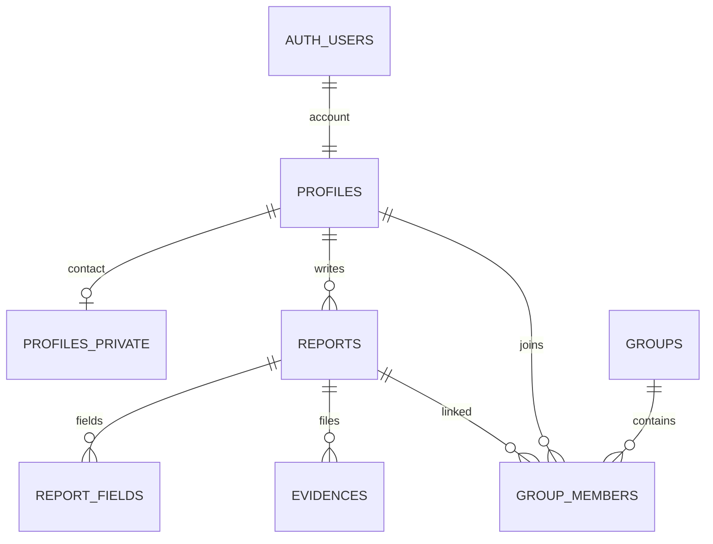
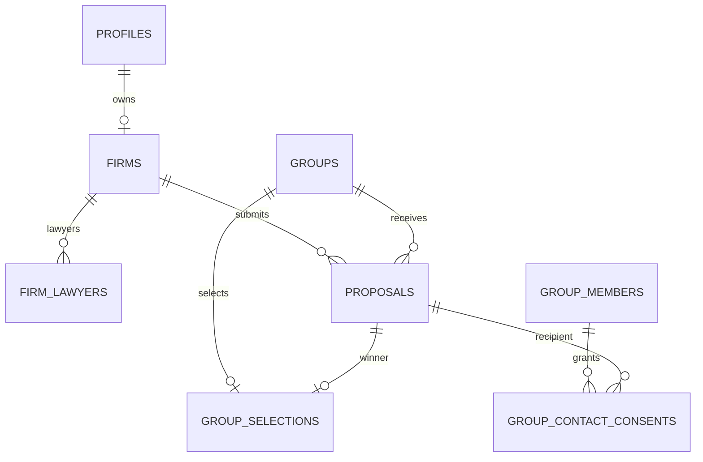
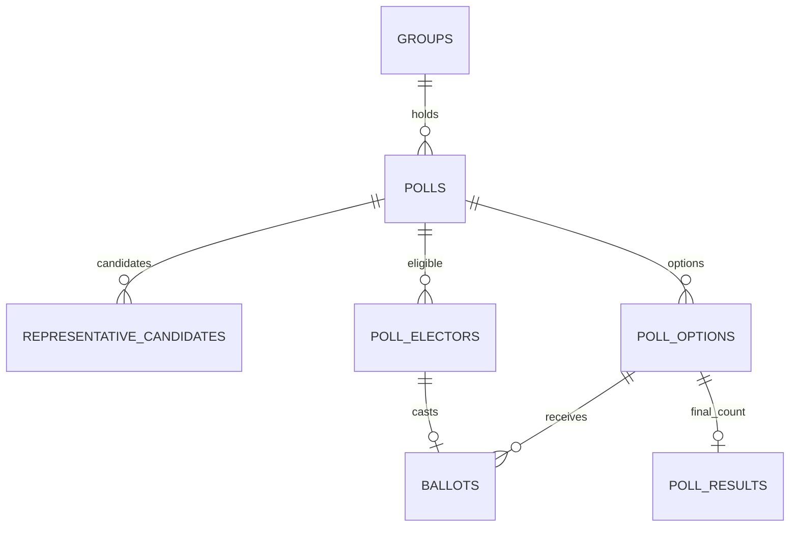

# 테이블·컬럼·관계

표기: PK=기본키, FK=외래키, UQ=유일 제약, NN=필수. `?`만 NULL 허용, 그 외 NN. uuid PK는 gen_random_uuid(), created_at은 now() 기본값. 코드값은 text+CHECK를 제안하며 실제 SQL 적용은 다음 구현 단계다. 개인·로펌 정보는 전부 예시 데이터로만 개발한다.

## 1. 계정과 로펌

### auth.users (Supabase 관리)

이메일·비밀번호 해시·인증 세션은 Supabase Auth가 관리한다. 직접 생성한 users 테이블에 비밀번호를 저장하지 않는다. 아래 profiles.id만 auth.users.id를 참조한다.

### profiles

| 컬럼 | 타입/제약 | 용도 |
| --- | --- | --- |
| id | uuid PK, FK auth.users.id | 인증 사용자와 1:1 |
| role | text CHECK user/firm | 가입 유형. 대표자와 운영자는 별도로 표현 |
| nickname | text, 길이 1~40 | 일반 사용자 표시 이름. 중복 닉네임 허용 제안 |
| created_at, updated_at | timestamptz | 가입/수정 시각 |

role은 가입 완료 후 직접 수정 불가. 로펌 표시 이름은 firms.firm_name에서 읽는다. nickname 길이·중복 정책은 구현 기본안이며 팀 변경 가능.

### profiles_private

| 컬럼 | 타입/제약 | 용도 |
| --- | --- | --- |
| user_id | uuid PK, FK profiles.id | 개인 프로필 1:1 |
| real_name | text | 가입 시 입력받는 실명 |
| phone | text | 앞자리 0 보존, 정규화 후 저장 |
| updated_at | timestamptz | 본인 수정 시각 |

로펌 제공 동의는 이 테이블의 전역 boolean으로 저장하지 않는다. 그룹별 동의 테이블을 사용한다. 일반 사용자 가입 완료 시 반드시 이 행이 존재하도록 가입 완료 RPC에서 검사한다.

### user_terms_acceptances

`id uuid PK`, `user_id uuid FK profiles.id`, `document_key text`, `version text`, `accepted_at timestamptz`.
UQ(user_id, document_key, version). 가입 약관/수집 안내 버전의 수락 이력. 로펌에 대한 정보 제공 동의와 별개다. 필수 문서 목록은 FE/기획이 제공한다.

### app_operators (비공개 스키마 권장)

`user_id uuid PK FK profiles.id`, `granted_at timestamptz`.
운영자 허용 목록. 신뢰된 DB 관리자만 관리한다. 사용자 입력 metadata나 수정 가능한 profiles 값으로 운영자를 승격하지 않는다.

### firms

| 컬럼 | 타입/제약 | 용도 |
| --- | --- | --- |
| id | uuid PK | 로펌 ID |
| owner_id | uuid FK profiles.id, UQ | 이번 버전은 계정 하나당 로펌 하나 |
| firm_name | text | 공개용 로펌명 |
| biz_no | text UQ, 숫자 10자리 CHECK | 사업자번호. 숫자형 아님 |
| biz_status | text CHECK unchecked/active/suspended/closed/unknown | 사업자 상태 |
| biz_checked_at | timestamptz? | 신뢰된 국세청 조회 완료 시각 |
| cert_path | text | 비공개 사업자등록증 경로 |
| approval_status | text CHECK pending/approved/rejected, 기본 pending | 운영자 승인 |
| reviewed_by | uuid? FK app_operators.user_id | 검토자 |
| reviewed_at | timestamptz? | 검토 시각 |
| reject_reason | text? | rejected이면 필수 CHECK |
| created_at, updated_at | timestamptz | 이력 |

owner 역할=firm 검사. 사업자 상태/승인 필드는 소유 로펌이 변경할 수 없다. 사업자번호·등록증·변호사 자격 정보 변경 시 재검토 필요 여부는 미정; 구현 전에는 승인된 계정의 해당 필드 직접 변경을 막는다.

### firm_lawyers

`id uuid PK`, `firm_id uuid FK firms.id`, `name text`, `reg_no text`, `created_at timestamptz`.
UQ(firm_id, reg_no). 제안서 제출 시 최소 1명 존재 검사. 번호 입력 자체를 자격 확인 완료로 취급하지 않는다.

## 2. 피해 사례와 증빙

### reports

`id uuid PK`, `user_id uuid FK profiles.id`, `raw_text text CHECK 길이 1~2000`, `status text CHECK draft/organized/submitted`, `created_at/updated_at timestamptz`.
UQ(id,user_id): 참여 관계에서 사례 작성자와 참여자가 동일한지 복합 FK로 확인한다. 비어 있는 초안은 브라우저 임시 저장으로 처리하고 DB 저장은 1자 이상. 일반 사용자만 생성한다.

### report_fields

| 컬럼 | 타입/제약 | 용도 |
| --- | --- | --- |
| report_id | uuid FK reports.id, 복합 PK 일부 | 대상 사례 |
| key | text CHECK company/type/notice_date/leaked/secondary/card, 복합 PK 일부 | 정리 항목 |
| ai_value | jsonb? | AI 원본 추출값 |
| quote | text? | AI가 사용한 원문 근거 |
| user_value | jsonb? | 사용자 수정값 |
| source | text CHECK ai/user | 현재 최종값 출처 |
| needs_check | boolean, 기본 true | 확인 필요 여부 |
| updated_at | timestamptz | 수정 시각 |

최종값은 source=user이면 user_value, 아니면 ai_value. JSON null을 값으로 사용하지 않고 SQL NULL을 사용한다. source=user이면 user_value 필수. 기간은 from/to(ISO 날짜)·precision, 유출 정보는 문자열 배열, 예/아니오/모름은 yes/no/unknown 등 key별 JSON 계약을 AI 담당자와 확정한다. 사용자 수정 시 ai_value/quote를 덮어쓰지 않는다. 현재 scope에서 type은 개인정보 유출만 제출 허용. 브라우저 AI 값은 검증된 사실/권한 판단 근거로 취급하지 않는다.

### evidences

`id uuid PK`, `report_id uuid FK reports.id`, `kind text`, `bucket_id text`, `object_path text UQ`, `original_name text`, `mime_type text CHECK image/jpeg,image/png,application/pdf`, `size_bytes bigint CHECK >0 AND <=10000000`, `status text CHECK pending/ready/failed`, `created_at timestamptz`, `uploaded_at timestamptz?`.

10MB는 10,000,000 bytes로 통일하는 구현 제안이다. Storage 설정/FE 표시와 동일하게 맞춘다. 최대 개수는 아직 미정이며 5개를 확정값으로 넣지 않는다. 파일 실체는 Storage, DB에는 경로와 메타데이터만 저장한다. ready만 통계에 포함하고 pending/실체 누락 파일은 제외한다.

## 3. 그룹과 동의

### groups

| 컬럼 | 타입/제약 | 용도 |
| --- | --- | --- |
| id | uuid PK | 그룹 ID |
| name, company | text | 공개용 제목/기업 |
| harm_type | text CHECK privacy_leak | 초기 피해 유형 |
| period_start, period_end | date? | 사건 기간. 둘 다 있으면 start<=end |
| description, conditions | text | 공개 설명/참여 조건 |
| required_evidence | text[] 기본 빈 배열 | 필요한 증거 종류 |
| goal | integer? CHECK >0 | 선택 목표 인원 |
| deadline | timestamptz? | 선택 모집 마감 |
| proposal_deadline | timestamptz? | 로펌 제안 접수 마감. 투표 마감과 구분 |
| status | text CHECK recruiting/connecting/in_progress/closed | 4단계 상태 |
| sub_status | text CHECK recruiting/rep_election/method_vote/proposal_collection/firm_vote/connected/closed | 세부 상태 |
| method | text? CHECK med/consumer/collective/suit | 확정 대응 방법 |
| created_by | uuid FK profiles.id | 개설자, 자동 대표자 아님 |
| result_summary | text? | 종결 요약 |
| created_at, updated_at | timestamptz | 이력 |

대표자는 group_members.is_rep, 선정 제안은 group_selections, 투표 시각은 polls에서 관리한다. groups에 대표자/선정 제안/투표 마감 시각을 중복 저장하지 않는다. 상태 조합은 permissions-and-rpc.md의 전이 규칙으로 제한한다.

### group_members

`group_id uuid FK groups.id`, `user_id uuid FK profiles.id`, `report_id uuid`, `damage_level text?`, `is_rep boolean 기본 false`, `joined_at timestamptz`, `left_at timestamptz?`, PK(group_id,user_id).

FK(report_id,user_id) → reports(id,user_id). 부분 UQ(group_id) WHERE is_rep AND left_at IS NULL: 활성 대표자는 그룹당 최대 1명. CHECK NOT is_rep OR left_at IS NULL. 피해 시기는 report_fields에서 조회하며 공개 목록에 원문/유출 정보/연락처를 붙이지 않는다. 같은 사례의 여러 그룹 연결 허용 여부는 미정이므로 report_id 단독 UQ를 임의로 만들지 않는다. 현재 합류 시각으로 재가입 자격을 판별한다.

### group_selections

`group_id uuid PK FK groups.id`, `proposal_id uuid UQ`, `firm_poll_id uuid UQ`, `selected_at timestamptz`.
FK(proposal_id,group_id) → proposals(id,group_id), FK(firm_poll_id,group_id) → polls(id,group_id). 투표 종류=firm, 마감/단독 최다 득표, 해당 제안 유효성을 마감 RPC에서 검증. 매핑의 로펌은 proposals.firm_id로 결정한다.

### group_contact_consents

`id uuid PK`, `group_id uuid`, `user_id uuid`, `proposal_id uuid`, `consent_version text`, `granted_at timestamptz`, `revoked_at timestamptz?`.
FK(group_id,user_id) → group_members PK. FK(proposal_id,group_id) → proposals(id,group_id). 부분 UQ(group_id,user_id) WHERE revoked_at IS NULL. revoked_at>=granted_at 검사. 동의할 때 실제 선정 제안인지 서버에서 확인한다.

동의 범위는 해당 그룹·해당 선정 제안의 로펌에 대한 실명/연락처 제공이다. 다른 그룹이나 다른 로펌에 자동 적용하지 않는다. 철회 시 앞으로의 조회를 차단한다(이미 내려받은 정보 회수와는 다름). 연락처 수정 후 재확인 절차는 구현 기본안으로 제공 동의를 다시 받는 방식을 제안한다. 증거 파일 제공 동의와 동일하게 취급하지 않는다. 법적 소송 참여 확정을 의미하지 않는다.

### notices / group_events

- notices: `id uuid PK`, `group_id uuid FK groups.id`, `author_id uuid FK profiles.id`, `title text`, `body text`, `created_at/updated_at timestamptz`. 대표자 작성 공지.
- group_events: `id uuid PK`, `group_id uuid FK groups.id`, `actor_id uuid? FK profiles.id`, `type text`, `payload jsonb`, `created_at timestamptz`. 시스템 단계 전이·선정 이력. 클라이언트 직접 쓰기 불가. payload에 개인정보를 포함하지 않는다.

v1의 사건번호/법원/소장 등 소송 관리 테이블은 v2의 연결 중심 범위에 추가하지 않는다. notices/group_events는 v2 대시보드의 소식과 상태 이력을 지원한다.

## 4. 투표와 제안서

### proposals

`id uuid PK`, `group_id uuid FK groups.id`, `firm_id uuid FK firms.id`, `retainer_fee numeric(14,0) CHECK >=0`(1인당 KRW), `success_fee_pct numeric(5,2) CHECK 0~100`, `period text`, `strategy text`, `lawyer_count integer CHECK >0`, `lead_lawyer text`, `status text CHECK draft/submitted/withdrawn`, `submitted_at timestamptz?`, `created_at/updated_at timestamptz`.
UQ(group_id,firm_id), UQ(id,group_id). 철회 후에도 새 행 대신 같은 제안 수정/재제출로 중복 방지. submitted에는 submitted_at 필수. 선정 여부는 group_selections에서 계산해 상태 이중 관리 방지. 추가 비용·유사 경험은 v2 F-03에 필수로 명시되지 않아 추가하지 않음.

### polls

| 컬럼 | 타입/제약 | 용도 |
| --- | --- | --- |
| id | uuid PK | 투표 회차 ID |
| group_id | uuid FK groups.id | 그룹 |
| kind | text CHECK representative/method/firm | 대표자/대응 방법/로펌 |
| round_no | integer CHECK >0 | 재투표 회차 |
| previous_poll_id | uuid? FK polls.id | 이전 회차 |
| state | text CHECK scheduled/open/closed/tied/no_votes/cancelled | 투표 상태 |
| opens_at, closes_at | timestamptz CHECK opens_at<closes_at | 기간 |
| opened_by | uuid FK profiles.id | 시작 요청자 |
| winner_option_id | uuid? | 단독 당선 선택지 |
| closed_at | timestamptz? | 집계 완료 |
| created_at | timestamptz | 생성 |

UQ(group_id,kind,round_no), UQ(id,group_id). 부분 UQ(group_id,kind) WHERE state IN (scheduled,open): 동시에 같은 종류의 진행 투표 하나만. FK(winner_option_id,id) → poll_options(id,poll_id)는 선택지 생성 이후 ALTER로 추가한다(순환 참조). previous_poll은 동일 그룹/종류와 다음 회차인지 RPC 검사. state=open이어도 closes_at이 지났으면 투표 불가.

### representative_candidates

`poll_id uuid`, `group_id uuid`, `user_id uuid`, `applied_at timestamptz`, PK(poll_id,user_id).
FK(poll_id,group_id) → polls(id,group_id), FK(group_id,user_id) → group_members PK. representative 종류와 활성 참여자 조건 검사. 후보 등록 종료와 투표 시작 사이에 선택지를 확정한다. 후보 모집 기간/시작 주체는 검토 항목이며 개설자 권한을 확정 사실로 두지 않는다.

### poll_options

`id uuid PK`, `poll_id uuid FK polls.id`, `method_code text? CHECK med/consumer/collective/suit`, `proposal_id uuid? FK proposals.id`, `candidate_user_id uuid? FK profiles.id`, `label text`.
UQ(id,poll_id). CHECK num_nonnulls(method_code,proposal_id,candidate_user_id)=1. 각각 UQ(poll_id,method_code/proposal_id/candidate_user_id). representative 선택지는 후보 복합 FK(poll_id,candidate_user_id)로 후보 존재 보장. 나머지는 해당 poll.kind와 그룹이 일치하는지 시작 RPC에서 검사한다. 투표가 열린 뒤 선택지 잠금.

### poll_electors

`poll_id uuid`, `group_id uuid`, `user_id uuid`, `eligible_at timestamptz`, PK(poll_id,user_id).
FK(poll_id,group_id) → polls(id,group_id), FK(group_id,user_id) → group_members PK. 투표 시작 시 활성 참여자의 자격 스냅샷을 만드는 **구현 제안**. 신규 합류·탈퇴·재가입 시 투표 자격 규칙은 검토 필요(implementation-plan.md). 후보와 유권자는 일반 참여자 계정만.

### ballots

`poll_id uuid`, `user_id uuid`, `option_id uuid`, `created_at/updated_at timestamptz`, PK(poll_id,user_id).
FK(poll_id,user_id) → poll_electors PK, FK(option_id,poll_id) → poll_options(id,poll_id). 같은 투표에 1인 1표. 선택 변경은 upsert. 시간·현재 참여 상태를 RPC에서 재검사. 다른 그룹 제안에 투표할 수 없다.

### poll_results

`poll_id uuid`, `option_id uuid`, `vote_count integer CHECK >=0`, `finalized_at timestamptz`, PK(poll_id,option_id).
FK(option_id,poll_id) → poll_options(id,poll_id). 마감 시 모든 선택지(0표 포함)의 최종 집계 스냅샷. 진행 중 득표는 ballots에서 집계, 최종 결과는 이 테이블에서 제공. 개별 투표 행의 공개는 불허한다.

## 5. 알림과 공공 집계

### notifications

`id uuid PK`, `user_id uuid FK profiles.id`, `group_id uuid? FK groups.id`, `type text`, `dedupe_key text`, `payload jsonb`, `created_at timestamptz`, `read_at timestamptz?`.
UQ(user_id,dedupe_key). 예: poll_closed:{poll_id}, proposal_submitted:{proposal_id}, representative_selected:{poll_id}. 재실행 때 같은 알림을 여러 번 보내지 않는다. 수신자/내용/발생 시각은 시스템만 변경, 본인은 read_at만 변경. 선택 기능이므로 핵심 투표 구현 후 연결.

### public_stats

`id uuid PK`, `source text`, `source_url text`, `period_start/period_end date`, `category text`, `metric text`, `count bigint CHECK >=0`, `as_of date`, `is_example boolean`, `updated_at timestamptz`.
UQ(source,period_start,period_end,category,metric), 기간 순서 CHECK. BE1 적재, 누구나 조회. 실제 외부 통계와 시연 수치를 구분. 대응 방법 추천 기준을 실제 법률 요건으로 단정하는 근거로 사용하지 않는다.

## 6. 관계도

### 사용자 → 사례 → 그룹

### 로펌 선정과 개인별 동의

### 투표별 회차·자격·선택

관계도는 주요 연결만 표시한다. 복합 FK의 상세는 위 테이블 정의를 따른다.

## 7. 인덱스·삭제 방침

| 인덱스 후보 | 용도 |
| --- | --- |
| reports(user_id,created_at DESC) | 내 피해 이력/RLS |
| evidences(report_id,status) | 증거 존재 확인 |
| groups(company,harm_type,status), groups(created_at DESC) | 후보 필터/목록 |
| group_members(user_id,left_at), group_members(group_id,left_at) | 내 그룹/집계/RLS |
| proposals(firm_id,status), proposals(group_id,status) | 내 제안/비교 |
| polls(closes_at) WHERE state IN (scheduled,open) | 마감 대상 탐색 |
| ballots(poll_id,option_id) | 득표 집계 |
| group_contact_consents(group_id,proposal_id) WHERE revoked_at IS NULL | 제공 허용 확인 |
| notices(group_id,created_at DESC), notifications(user_id,created_at DESC) | 이력 조회 |

DDL 구현 시 참조 FK별 조회 패턴도 확인해 필요한 인덱스를 추가한다.

- 회원 탈퇴는 v2 필수 범위 밖이다. Auth 계정 삭제가 공개 그룹·투표 결과를 무조건 연쇄 삭제하지 않도록 FK 삭제는 원칙적으로 RESTRICT를 제안한다.
- 아직 제출·참여하지 않은 draft 삭제만 본인 RPC로 허용한다. report_fields/evidences 메타데이터와 Storage 실체 삭제를 재시도 가능한 절차로 처리한다.
- 제출된 사례·투표에 사용된 행의 물리 삭제는 제한하고 참여 취소/철회 상태로 관리한다. 탈퇴 및 저장 기간의 최종 규칙은 별도로 결정한다.
